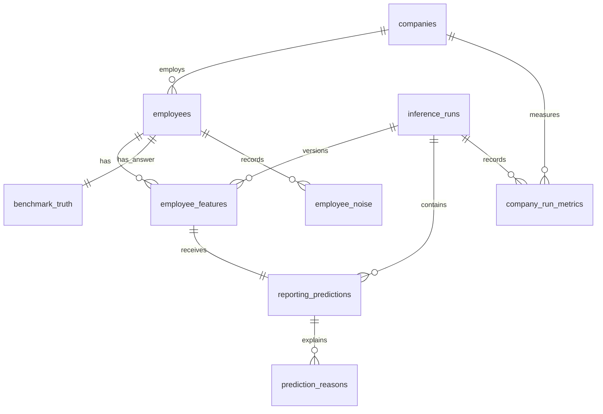

# Database design

SQLite is enough for this read-only app: one file, explicit SQL, no database
service to provision, and the same constraints can be checked locally. The
database contains relational records rather than a JSON document per company.
Flask reads those records with joins and rebuilds the existing page payload.

## Tables and grain

| Table | One row represents |
|---|---|
| `companies` | One company and its declared headcount. |
| `employees` | One employee in a company, with the original input fields. |
| `employee_features` | One employee's inferred department and seniority for a run. |
| `inference_runs` | One imported source snapshot, its hashes, thresholds, counts, and load status. |
| `reporting_predictions` | One employee's decision in a run, including unresolved decisions. |
| `company_run_metrics` | One company's saved evaluation summary for a run. |
| `benchmark_truth` | One employee's generated answer, stored separately from predictions. |
| `prediction_reasons` | One ordered explanation for a prediction. |
| `employee_noise` | One ordered title-noise label from the generated dataset. |



Employee keys include `company_id`. Prediction references include `run_id` as
well, so an employee, accepted manager, and leading candidate must belong to
the same company and run. A candidate is evidence to inspect; it is not an
accepted reporting line.

## Input, prediction, and answer stay separate

`employees` comes from `data/employees_messy.csv`. Blank titles, departments,
teams, and locations stay blank in the database. Synthetic email addresses are
retained too. Display labels such as “Title unavailable” are added when the
page payload is reconstructed, not written over the raw records.
`source_row_number` points back to the CSV line, including its header, and
preserves the original employee order when reconstructing a company page.

The exported company files supply inferred attributes, scores, decisions, and
explanations. The model is not rerun during database loading. A prediction can
be `accepted`, `unresolved`, or `company_root`; only an accepted manager creates
a chart edge. An inferred company root comes from the observed CEO title.

`benchmark_truth` comes from the separate generated answer file. It is used for
comparison and evaluation, not to fill gaps in the inferred chart. A generated
CEO with a missing title can therefore remain unresolved in the app. Counts
based on inferred roots and counts excluding benchmark roots need not match.

Company evaluation summaries have their own company/run grain. These preserve
the original exported metrics: averaging already rounded employee scores can
change the last decimal place. The saved summary is not a substitute for the
individual prediction rows.

## Constraints and checks

- Composite foreign keys prevent references to people in another company or
  another inference run. SQLite foreign-key enforcement is enabled on each
  application connection.
- The prediction key permits one decision per employee and run. A nullable
  accepted manager represents abstention.
- Score checks keep confidence and margin between zero and one, with margin
  no greater than confidence. Self references are rejected.
- An accepted decision must name its leading candidate as its manager. Other
  decisions have no accepted manager.
- Startup validation checks reporting cycles and seniority before publishing
  the imported snapshot. A manager must be more senior than the report.

The current source contains 500 companies, 87,873 employee records, and 33,123
accepted reporting lines. The source requirements are checked separately from
model quality: satisfying a foreign key does not prove a reporting line is
correct.

## Lineage and rebuilding

`inference_runs` records the full source hash, model hash, pipeline hash,
acceptance thresholds, expected and loaded row counts, status, and load time.
The source hash covers the input and prediction artifacts used by the loader.
The stable run key is derived from that hash.

Startup loads the current snapshot into a temporary database in a transaction.
It checks that database before replacing the previous file. Repeating an
import with the same files produces the same relational values and run key;
the load time is refreshed. This is a rebuildable current-state database, not
a historical warehouse. Older employee snapshots and prediction runs are not
retained.

The database lives at `instance/orggraph.sqlite3` and is excluded from source
control and the source package. Start the app to build it. To rebuild from scratch,
remove that database file and start the app again. No training is required.

## Read-only inspection

The app's `/data.html` page lets you inspect the schema, foreign keys, and
example queries. SQL runs against a database copy in the browser. It accepts
one `SELECT`, `WITH`, or `EXPLAIN` statement, shows at most 200 rows, and stops
queries that run longer than five seconds. It cannot change the server's data.
Normal Flask database connections are also opened read-only.

The current snapshot is available at `/database/snapshot.sqlite.gz`. It
contains synthetic input records, inferred attributes, predictions, and the
separate generated answer key. After downloading it, inspect a local copy:

```bash
gzip -dc snapshot.sqlite.gz > orggraph.sqlite3
sqlite3 -readonly -header -column orggraph.sqlite3 < scripts/quality_checks.sql
```

The compressed download is created from the validated startup snapshot. It is
a generated runtime artifact, not a second database kept in source control.

## Inspect it with SQL

After starting the app, run:

```bash
sqlite3 -header -column instance/orggraph.sqlite3 < scripts/quality_checks.sql
```

The script shows source lineage and row counts, then checks foreign keys,
declared headcounts, prediction cardinality, decision consistency, seniority,
cycles, and raw-field missingness. Checks that return violating records should
return no rows. It also includes examples for a manager chain, unresolved
people, and team counts. Change the example company and employee IDs to explore
another part of the dataset.

These SQL checks cover the imported snapshot. The Results page still reports
model quality on the 75 held-out test companies, a different population from
all 500 companies in the database.
